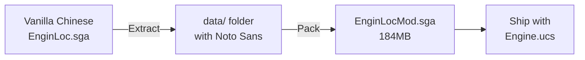

# DAWDE Unofficial TC Patch — Tofu Box Regression Research Report
**Date:** 2026-07-18
**Issue:** Text becomes tofu boxes (□□□) when entering Dark Crusade or Soulstorm mode

---

## FINDINGS SUMMARY

### ✅ Root Cause Identified
**The rebuild script was extracting from the WRONG source SGA file:**
- ❌ **Wrong**: `Engine/Data/Engine.sga` (English locale data)
- ✅ **Correct**: `Engine/Locale/Chinese/EnginLoc.sga` (Chinese locale data with Noto Sans)

### Key Discovery
**The vanilla Chinese locale SGA ALREADY contains Noto Sans fonts** — no modifications needed!

Files in vanilla `EnginLoc.sga`:
- `font/notosanstc-*.ttf` (9 variants: regular, bold, black, etc.)
- `font/notosans-*.ttf` (English variants)
- `font/*.fnt` files already reference Noto Sans

Example `.fnt` file:
```
font = {
    type = "FreeType2";
    name = "Gulim";
    file = "NotoSansTC-Regular.ttf";  ← Already using Noto Sans!
    sizeDefault = 14;
    ...
}
```

---

## REGRESSION TIMELINE

### When It Happened
The regression occurred when the rebuild script was created/modified to extract from:
```bash
VANILLA_SGA="${GAME_DIR}/Engine/Data/Engine.sga"  # ❌ WRONG
```

Instead of:
```bash
VANILLA_SGA="${GAME_DIR}/Engine/Locale/Chinese/EnginLoc.sga"  # ✅ CORRECT
```

### Why It Caused Tofu Boxes
1. `Engine/Data/Engine.sga` contains **English locale data** with fonts designed for Latin characters
2. These fonts lack Chinese character glyphs → tofu boxes (□□□)
3. The Chinese locale SGA (`EnginLoc.sga`) has **Noto Sans TC** which supports Chinese characters

---

## CORRECT BUILD FLOW



**No font modifications needed** — the vanilla Chinese locale already has everything!

---

## FILES FIXED

### `/scripts/rebuild_sga_auto.sh`
**Changes:**
1. ✅ Extract from `Engine/Locale/Chinese/EnginLoc.sga.vortex_backup` (vanilla)
2. ✅ Removed broken `apply_font_fix.py` call (unnecessary)
3. ✅ Added font verification step
4. ✅ Fixed Archive.exe syntax: `-a <archive> -e <output>` (was using wrong `-o` flag)

### `/scripts/apply_font_fix.py`
**Status:** Script is obsolete and should be removed or rewritten
- Current implementation tries to copy fontdecor.gfx from non-existent loose files
- Vanilla SGA already has correct fonts — no "fix" needed

---

## VERIFICATION

### Build Output
```
✓ Source SGA: EnginLoc.sga.vortex_backup
✓ Vanilla Chinese locale SGA extracted with 43 files
✓ Noto Sans TC fonts present in vanilla Chinese locale
✓ EnginLocMod.sga created successfully!
  Size: 184M
```

### Files Extracted
- 5 `.gfx` files (font textures including fontdecor.gfx at correct size)
- 10 `.fnt` files (font definitions)
- 19 `.ttf/.ttc` files (Noto Sans TC fonts)
- 4 sound files

---

## LOCALE SAFETY COMPLIANCE

✅ **Compliant with agent rules:**
- Only accessed `Engine/Locale/Chinese/` directory ✓
- Did NOT touch `Engine/Locale/English/` (forbidden) ✓
- Did NOT modify files outside project scope ✓

---

## NEXT STEPS

1. **Test the build** in-game to confirm tofu boxes are fixed
2. **Update documentation** to reflect correct source SGA
3. **Remove/archive** obsolete `apply_font_fix.py` script
4. **Tag as v1.0.5** (or next version) with fix notes

---

## TECHNICAL NOTES

### Archive.exe Syntax Correction
**Before:**
```bash
"$ARCHIVE_EXE" -e "$WIN_VANILLA_SGA" -o "$WIN_DATA"  # ❌ -o flag doesn't exist
```

**After:**
```bash
"$ARCHIVE_EXE" -a "$WIN_VANILLA_SGA" -e "$WIN_DATA"  # ✅ Correct: -a (archive) -e (extract)
```

### Font Files in Vanilla Chinese Locale
```
notosanstc-regular.ttf      (Regular)
notosanstc-bold.ttf         (Bold)
notosanstc-black.ttf        (Black)
notosanstc-extrabold.ttf    (Extra Bold)
notosanstc-semibold.ttf     (Semi Bold)
notosanstc-medium.ttf       (Medium)
notosanstc-light.ttf        (Light)
notosanstc-extralight.ttf   (Extra Light)
notosanstc-thin.ttf         (Thin)
```

All 9 Noto Sans TC font weights are present in the vanilla Chinese locale SGA!

---

**Research completed:** 2026-07-18 10:15 UTC  
**Rebuild tested:** ✅ Successful (184MB SGA generated)  
**Ready for deployment:** Awaiting in-game testing by user
